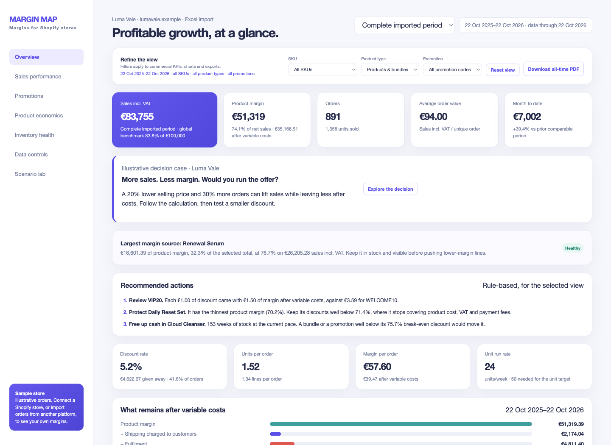
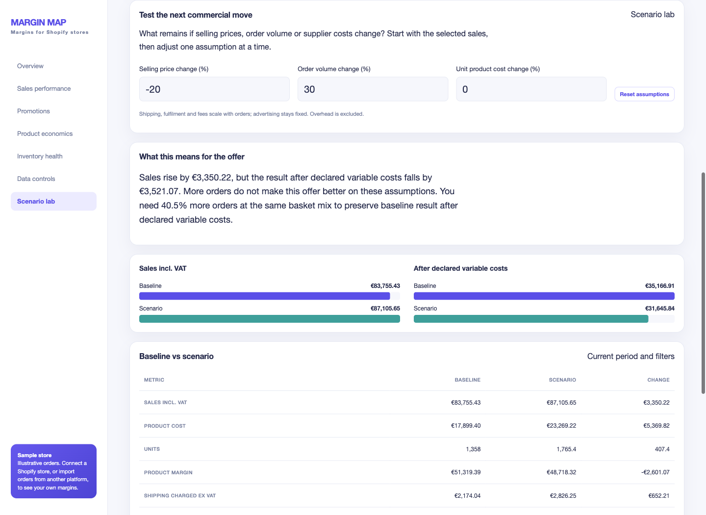

# Margin Map

**Understand what remains after costs before changing prices or promotions.**

[](https://github.com/eduardosalomonm/margin-map/actions/workflows/verify.yml)

Margin Map connects to a Shopify store through the Admin API with read-only
access, combines its orders with the store's product costs, and produces an
interactive margin dashboard and a one-page executive PDF. Stores on other
platforms (WooCommerce, PrestaShop, marketplaces) get the same analysis by
pasting an order export into the included Excel template.

**[Try the decision →](https://marginmap.eilvi.com/#decision-case)** ·
**[Read the case →](CASE_STUDY.md)** ·
**[Quick start →](TLDR.README/README.md)** ·
**[User guide →](USER_GUIDE.md)**



The public example uses **Luma Vale**, a synthetic store. Follow the guided offer
comparison online, or open `docs/index.html` locally and choose **Explore the decision**.

## A decision, not just a dashboard

Would you reduce prices by 20% to get 30% more orders? In the illustrative case,
sales rise 4%, but the result after declared variable costs falls. The demo compares
that offer with a smaller discount, shows the order-growth threshold needed to
preserve margin, and exposes the assumptions behind both outcomes.

The project grew from using dashboards to understand my own business's numbers.
The public case does **not** claim a historical campaign, measured financial uplift
or a verified real-store Shopify pilot. [The case study](CASE_STUDY.md) separates
that origin, the illustrative decision and the engineering evidence.

## What it answers

- **Which products and bundles carry the margin**, after discounts, VAT and product cost.
- **What each discount code costs**, from Shopify's final line allocations rather than assumed rates.
- **What remains after the costs of selling**: shipping charged, fulfilment, payment fees
  and advertising, allocated so that every filter still adds up to the store total.
- **How deep a discount can go** before a product stops covering its cost.
- **What a price, volume or cost change would do**, in the Scenario lab.
- **How many weeks of stock are left** at the current pace, bundles included.



The Scenario lab scales order-related costs with volume and percentage fees with
price; advertising stays fixed. It is sensitivity analysis, not a demand forecast
or causal attribution. It runs in the browser and leaves the source data unchanged.

## Connect a Shopify store

1. **Create the app.** In the Shopify Dev Dashboard, create an app in the same
   organization as the store, install it on the store and grant read-only scopes:
   `read_orders`, `read_products`, `read_inventory` (product costs and stock) and
   `read_all_orders` (orders older than 60 days). Copy `.env.example` to `.env` and
   add the `myshopify.com` domain, client ID and client secret. Margin Map exchanges
   them directly with Shopify for a short-lived token on every run. Credentials
   stay out of reports, source control and the public demo.
2. **Draft the cost model from Shopify.** This reads each variant's price, stock
   and *Cost per item* and writes `costs.private.json`. Variants without a cost are
   listed and left out, so their sales block publication until a cost is declared:

   ```bash
   python3 src/check_access.py
   python3 src/bootstrap_costs.py
   ```

   Shopify exposes the current cost, not its history. The draft records it from
   today's observation date. Supply earlier dated costs in `productos[SKU].costes`
   before importing older sales; uncovered dates block the report. See
   [historical costs](USER_GUIDE.md#historical-product-costs).

   Review the VAT rate, declare bundles and, optionally, variable costs (amounts
   ex VAT, advertising by month; shipping charged is read from each order):

   ```json
   "costes_variables": {
     "logistica_por_pedido": 5.40,
     "comision_pago_pct": 1.5,
     "comision_pago_fija": 0.25,
     "publicidad": {"2026-09": 920, "2026-10": 1035}
   }
   ```

3. **Build the dashboard and PDF** with one command. Pass the unit total that
   Shopify Analytics reports for the same window to stop on any mismatch:

   ```bash
   python3 src/run_shopify_dashboard.py --since 2025-01-01 --expected-units 1240 --open
   ```

   Each extraction is stored unchanged, so every figure can be traced back to it.

### What the Shopify path accounts for

- **Returns, refunds and order edits:** each line counts by the quantity still sold,
  money refunded without a return is deducted from the order's sales, and a
  returned order keeps the fulfilment and payment fee it already cost.
- **Real VAT per line** from Shopify's tax lines, including reduced rates, and
  tax-exclusive stores where VAT is added on top of the price.
- **Shipping after shipping discounts**, and dates in the shop's own timezone.
- **Gift cards and voided or expired orders** are excluded and reported, so the
  totals can be reconciled with Shopify.
- **Price changes, Markets and B2B prices** are reported per SKU instead of
  blocking publication; margins use the price actually charged.
- **Resilient extraction:** retries on rate limits, outages and timeouts, and
  smaller pages automatically when a query is too large for Shopify.

Exact payment-provider fees (Shopify Payments balance transactions) are not yet
read; declare the provider's rate as a variable cost. "Sales incl. VAT" is what
customers paid after discounts, which differs from Shopify Analytics' *Gross
sales* (before discounts, ex tax).

## Other platforms: the Excel template

Open [assets/unit-economics-input.xlsx](assets/unit-economics-input.xlsx), replace
the sample orders, catalogue and settings with the store's own, save, then
double-click `Run dashboard.command` (macOS) or `Run dashboard.bat` (Windows). The
dashboard and PDF open in the browser. Edit only yellow cells; blue cells calculate.

The workbook starts on a formula-driven `Dashboard` sheet. Native recalculation
uses `LET`, `XLOOKUP` and `TEXTSPLIT` (Excel 365 / Excel 2024; recalculation tested
with LibreOffice 26.8.2, not native Excel); the Python
dashboard reads the inputs independently and does not require Excel. In `Scenario`
mode, catalogue prices and promotion rates
flow through to the orders, which makes price experiments quick; switch `Pricing
model` to `Actual` for recorded orders and sale-date product costs. Add historical
costs in `Pricing & promotions`; dates for each SKU must be oldest first.
See the [user guide](USER_GUIDE.md)
for every column.

## Built-in checks

A dashboard is not published while integrity checks fail. They catch:

- SKUs without a declared cost, which would otherwise produce an invented margin;
- bundle claims that do not match their components;
- discount allocations that break their declared rule;
- inconsistent VAT treatment, and prices that differ from the price history in `Actual` mode.

Warnings that do not block publication are listed, with their explanation, under
**Data controls**.

## Calculation scope

**Product margin** is sales after discounts and VAT, minus declared product
costs. When variable costs are declared, **after variable costs** also adds the
shipping customers paid and deducts fulfilment, payment fees and advertising.
Per-order amounts are allocated to lines by what the customer paid; monthly
advertising by each line's share of that month's net revenue.

Missing variable inputs are **excluded, not confirmed zero**. The dashboard and
exports disclose an incomplete known-cost subtotal; enter an explicit `0` for a
known zero cost. **Data controls → Input assumptions** distinguishes dated costs,
declared rates, missing inputs and allocated advertising. Refund adjustments stay
on the original order date rather than their cash-flow date.

Neither figure is net profit: salaries, rent, software and other overhead are
excluded. Returns and refunds are deducted when the order data records them;
the Excel template records sales as entered. The **break-even discount**
covers product cost, VAT and the percentage payment fee only. Margin Map is
decision support, not accounting or tax software.

## For developers

A JSON fixture covers the Shopify path in automated verification:

```bash
python3 src/make_demo_data.py
COSTS_FILE=costs.example.json SNAPSHOT=data/raw/orders-demo.json python3 src/transform.py
COSTS_FILE=costs.example.json SNAPSHOT=data/raw/orders-demo.json python3 src/checks.py
# The online dashboard is rebuilt from the workbook, with a fixed last trading date.
python3 src/make_demo_workbook.py --as-of 2026-10-22
python3 src/run_excel_dashboard.py --output docs/index.html
python3 -m unittest discover -s tests -v
node --test tests/test_*.js
```

Run
`python3 src/make_demo_data.py --with-errors` to create an explicit invalid fixture;
the checks and normal publication must fail.

## How it works

An editable workbook or a Shopify snapshot is parsed and validated, order lines
are transformed into SQLite, integrity checks gate publication, and a static HTML
dashboard plus PDF is generated. The HTML embeds its data and scripts, so it opens
offline with no server or account. Python and the standard library are enough;
GitHub Actions verifies calculations, privacy boundaries and reproducible builds.

### Implementation guarantees

- **Immutable raw snapshots.** Every number can be traced back to an extracted
  input file.
- **No invented costs.** An unknown SKU produces an error, not a guessed margin.
- **Historical prices.** Actual mode checks orders against the price active on that date;
  Scenario mode deliberately uses the editable current catalogue price.
- **Historical costs.** Actual mode resolves dated costs for products and bundle
  components; current Shopify observations do not rewrite earlier entries.
  Legacy undated models remain supported with a warning, not a claim of history.
- **Final discount allocations.** Shopify’s allocated line discount is used when
  available, rather than reverse-engineering discounts from totals.
- **Private data stays private.** Credentials and cost models are local and ignored by Git; the published workbook holds sample data only.
- **Safe store text.** Imported names, SKUs and promotion codes are escaped before
  entering dashboard markup; spreadsheet exports neutralise formula-like text.
- **Reproducible publication.** Dashboard and PDF dates come from the latest order
  in the snapshot, so rebuilding the same workbook produces the same deliverables.
- **Nothing is inferred that was not measured.** Stock on hand drives the inventory
  view; without it the tab says so instead of estimating stock from sales.

## Project layout

```text
assets/                           Excel template with the sample store
docs/                             Online dashboard and executive-summary PDF
src/                              Python pipeline, Excel workflow, and dashboard source
tests/                            Automated calculation and interface checks
TLDR.README/                      Quick start for non-technical users
costs.example.json                Example cost model to copy for a Shopify store
Run dashboard.command / .bat      One-click Excel workflow launchers for macOS / Windows
README.md                         Project overview and quick start
USER_GUIDE.md                     Step-by-step guide for non-technical users
CONTRIBUTING.md                   Development and verification conventions
CHANGELOG.md / VERSION            Release history and current version
RELEASE_CHECKLIST.md              Privacy, reproducibility and publication checks
```

The Excel workflow isolates each build in a temporary working folder and removes
its intermediate files automatically. It generates both deliverables before
replacing the dashboard and PDF, so calculation or rendering errors preserve the
previous report. Use different output folders for reports from different stores:
each folder contains one `executive-summary.pdf`.

The JSON/Shopify pipeline creates its working files in ignored `data/`; local
Excel reports live in ignored `output/`. These working folders are deliberately
excluded from the GitHub package and are recreated when needed.

## License

MIT
